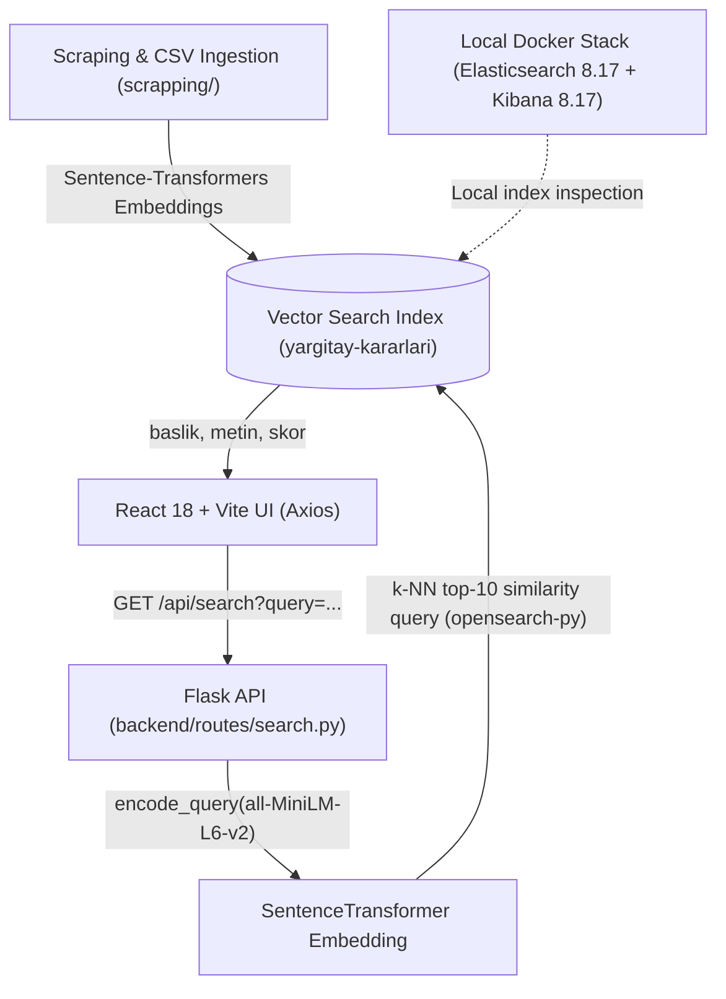

# Yargıtay Karar Arama — Semantic Legal Precedent Search Engine

A full-stack semantic legal precedent search engine for Turkish Supreme Court (*Yargıtay*) rulings, combining **Sentence-Transformers** vector embeddings (`all-MiniLM-L6-v2`), **Elasticsearch / OpenSearch k-NN indexing**, a **Flask** search API, and a **React + Vite** search interface.

**[Live Demo](https://yargitay-karar-arama.vercel.app)** · **[Portfolio](https://kadircelikportfolyo.vercel.app/#projects)**

---

## Architecture



---

## Key Engineering Highlights & Trade-Offs

- **Semantic k-NN Retrieval (`backend/services/model_service.py`, `elastic_service.py`)**: Natural-language legal queries passed to `GET /api/search?query=...` are encoded via `SentenceTransformer('all-MiniLM-L6-v2')` and matched against dense `vektor` embeddings in the `yargitay-kararlari` index using k-NN similarity (`k = 10`, `size = 10`) to surface conceptually relevant rulings beyond exact keyword matches.
- **Scraping & Indexing Pipeline (`scrapping/`)**: Collects and stores ruling records (`yargitay_kararlari.csv`) and handles batch vector indexing (`elasticsearch_integration.py`).
- **Containerized Local Search Stack (`docker-compose.yml`)**: Spins up **Elasticsearch 8.17** (`9200`) and **Kibana 8.17** (`5601`) in single-node development mode for local index setup and inspection.
- **React 18 + Vite Frontend (`frontend/`)**: Lightweight search interface powered by Axios to submit queries and inspect ranked precedent summaries and similarity scores.

---

## Project Structure

```text
Yargitay-Karar-Arama/
├── backend/
│   ├── routes/search.py              # Flask GET /api/search endpoint
│   ├── services/
│   │   ├── elastic_service.py        # OpenSearch k-NN top-10 vector search client
│   │   └── model_service.py          # SentenceTransformer query encoder
│   ├── application.py                # Flask application entrypoint
│   ├── config.py                     # Index endpoint & model configuration
│   └── requirements.txt
├── frontend/
│   ├── src/                          # React 18 UI + Axios search integration
│   ├── package.json
│   └── vite.config.js
├── scrapping/
│   ├── scrapping.py                  # Supreme Court ruling scraper
│   ├── elasticsearch_integration.py  # Embedding & index loader
│   └── yargitay_kararlari.csv        # Collected precedent dataset
└── docker-compose.yml                # Elasticsearch 8.17 + Kibana 8.17 stack
```

---

## Local Setup & Verification

### 1. Start Elasticsearch & Kibana

```bash
docker compose up -d
```

- Elasticsearch: `http://localhost:9200`
- Kibana: `http://localhost:5601`

### 2. Run the Flask API

```bash
cd backend
python -m venv .venv
# Windows PowerShell: .venv\Scripts\Activate.ps1 (or source .venv/bin/activate on macOS/Linux)
pip install -r requirements.txt
python application.py
```

### 3. Run the React Frontend

```bash
cd frontend
npm install
npm run dev
```
